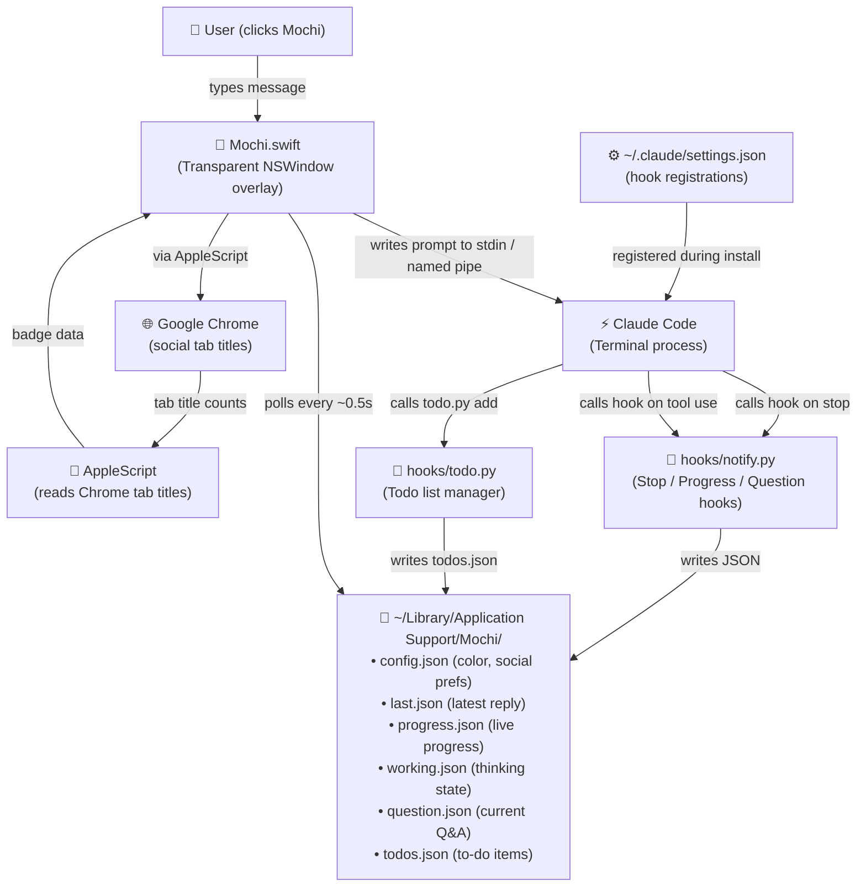
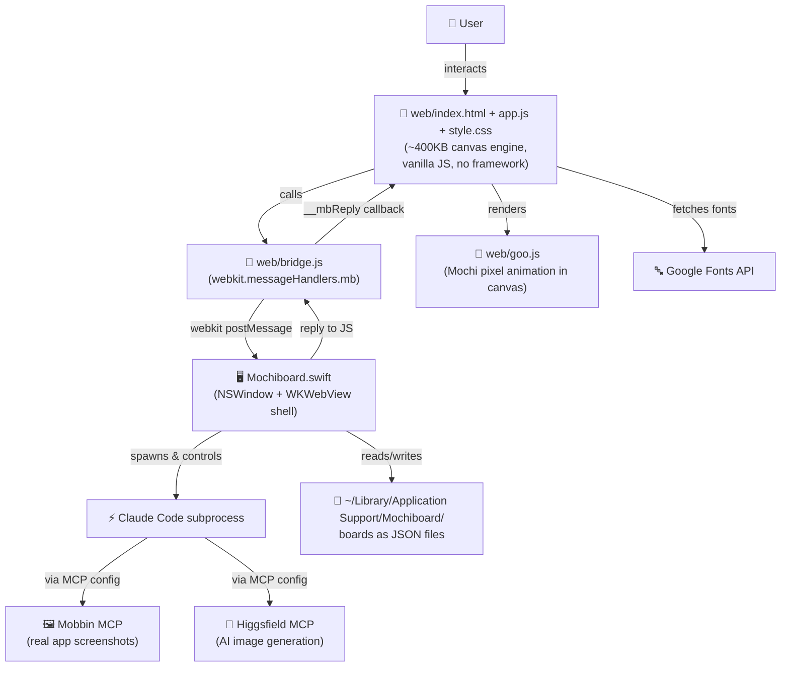
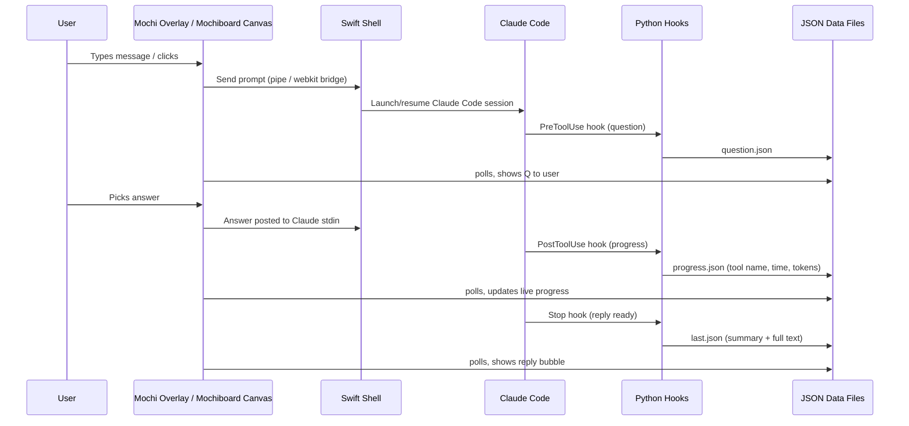
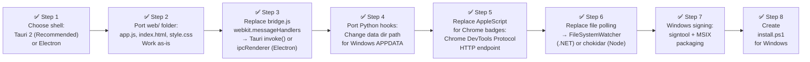

# 🫧 Mochi & Mochiboard — Full Technical Review

> Repos: [jessawolfe-ux/mochi](https://github.com/jessawolfe-ux/mochi) · [jessawolfe-ux/mochiboard](https://github.com/jessawolfe-ux/mochiboard)

---

## 1. What Are These Projects?

| | **Mochi** | **Mochiboard** |
|---|---|---|
| **Summary** | A tiny pixel-art mascot overlay that floats over your Mac desktop and acts as a live UI for Claude Code running in Terminal | A freeform infinite planning canvas ("whiteboard") for Mac that embeds Mochi as its AI assistant |
| **Primary language** | Swift (95 KB single-file app) + Python hooks | Swift (45 KB single-file app) + JS/HTML/CSS canvas |
| **Architecture style** | Transparent overlay window + Claude Code hooks | SwiftUI WKWebView shell + WebKit canvas app |
| **Mac requirement** | macOS 13+, swiftc CLI tools | macOS 13+, Apple chip or Intel |
| **Claude integration** | Via Claude Code transcript hooks (`~/.claude/settings.json`) | Via Claude Code subprocess + `window.webkit.messageHandlers` bridge |
| **Data storage** | `~/Library/Application Support/Mochi/` (JSON files) | Files via Swift, boards in local files |

---

## 2. System Architecture

### 2A. Mochi Architecture



### 2B. Mochiboard Architecture



### 2C. End-to-End Data Flow (Both Apps Combined)



---

## 3. Windows Porting — What Needs to Change

Both apps are **deeply Mac-only** by design. Here's a comprehensive breakdown:

### 3A. The Mac-Specific Stack

| Layer | Mac-only Component | Windows Equivalent |
|---|---|---|
| Language | Swift (via `swiftc` CLI tools) | ❌ Swift has experimental Windows support, but no AppKit/SwiftUI |
| UI framework | `AppKit`, `NSWindow`, `NSPanel`, `SwiftUI` | Must rewrite in C# (WinForms/WPF/WinUI3) or Electron/Tauri |
| Web embedding | `WKWebView` (WebKit) | `WebView2` (Chromium-based, Microsoft-maintained) |
| Window management | `NSScreen`, transparent `NSPanel`, `always-on-top` | `User32.dll` APIs (SetWindowPos, WS_EX_LAYERED, WS_EX_TOPMOST) |
| IPC (JS↔Native) | `window.webkit.messageHandlers.mb` | `WebMessageReceived` (WebView2 equivalent) |
| App sandbox / signing | Ad-hoc `codesign`, `.app` bundles | Code signing via `signtool`, `.exe`/`.msix` |
| Build system | `swiftc` (Xcode CLI tools) | MSBuild / .NET SDK / `dotnet build` |
| Data dir | `~/Library/Application Support/` | `%APPDATA%\Mochi\` or `%LOCALAPPDATA%\Mochi\` |
| Chrome AppleScript | `osascript` / AppleScript | Chrome debugging protocol (`--remote-debugging-port`) or UIA |
| Hooks (Python) | Works on any OS ✅ | Works directly — no changes needed |
| Canvas web code | Vanilla JS — portable ✅ | Works directly — no changes needed |
| Install scripts | `bash` + `swiftc` | PowerShell + `dotnet build` or WinUI installer |
| Notifications | `NSUserNotification`, `UNUserNotificationCenter` | `Windows.UI.Notifications` / Toast notifications |
| File watching | `DispatchSource.makeFileSystemObjectSource` | `FileSystemWatcher` (.NET) |
| Social badges | AppleScript on Chrome | Chrome DevTools Protocol (`/json` endpoint) |
| App launch | `launchd`, `LoginItems` | Windows Task Scheduler or Registry run keys |

### 3B. Recommended Windows Port Strategy

> [!IMPORTANT]
> The cleanest cross-platform approach is **Tauri 2** (Rust shell + WebView2 + the existing JS canvas) for Mochiboard, and a **WPF/WinUI3 overlay** or **Electron app** for Mochi.

#### Option 1 — Tauri 2 (Recommended for Mochiboard)
- The entire `web/` folder (index.html, app.js, style.css, bridge.js) is pure JS — it ports without changes.
- Replace `WKWebView` Swift shell with Tauri's Rust webview (which uses WebView2 on Windows).
- Replace `window.webkit.messageHandlers.mb` bridge in `bridge.js` with `window.__TAURI__.invoke()`.
- Replace file I/O Swift code with Tauri's `tauri-plugin-fs`.
- Spawning Claude Code works via `tauri-plugin-shell`.
- **Platforms supported**: Windows, macOS, Linux.

#### Option 2 — Electron (Fallback)
- Simpler to migrate — exposes Node.js APIs to the canvas directly.
- Higher memory usage (~150MB base vs. ~30MB for Tauri).
- Chrome DevTools Protocol built-in (for social badge reading).

#### Option 3 — .NET WinUI3 (Mochi overlay only)
- Best if you want Mochi as a true desktop pet on Windows.
- Use `WebView2` to render the goo + bubbles.
- Use `User32` P/Invokes for always-on-top transparent window.
- Use `FileSystemWatcher` to replace file polling.

### 3C. Mochi Python Hooks — Windows Changes Needed

The `hooks/notify.py` and `hooks/todo.py` are mostly portable. Minor changes:

```diff
- DIR = os.path.expanduser("~/Library/Application Support/Mochi")
+ import platform
+ if platform.system() == "Windows":
+     DIR = os.path.join(os.environ.get("APPDATA", ""), "Mochi")
+ else:
+     DIR = os.path.expanduser("~/Library/Application Support/Mochi")
```

- AppleScript calls (for Chrome badge reading in Mochi) must be replaced with **Chrome DevTools Protocol**:
  - Start Chrome with `--remote-debugging-port=9222`
  - Query `http://localhost:9222/json` to get tab titles

---

## 4. Security Vulnerabilities

### 🔴 HIGH: No Input Sanitization in IPC Bridge (Mochiboard)

**File:** `web/bridge.js`

```js
// Current code - no validation
const call = (op, args = {}) => new Promise((res, rej) => {
    const id = ++seq;
    waiting.set(id, { res, rej });
    window.webkit.messageHandlers.mb.postMessage({ id, op, args });
});
```

**Problem:** Any JS running in the WKWebView can call arbitrary `op` values (file operations, Claude Code execution, etc). If a malicious link is loaded on the board, it can call `bridge.call('exec', { cmd: 'rm -rf ~' })` or equivalent. The Swift side must whitelist valid operations and sanitize all args before acting on them.

**Fix:**
- Whitelist allowed `op` values on the Swift side
- Validate and sanitize `args` before passing to file system or shell
- Set `allowsArbitraryLoads = false` in the WKWebView config
- Pin the webview to `file://` or a custom URL scheme only

---

### 🔴 HIGH: Hardcoded Local Signing Certificate — Not Gatekeeper-Safe

**File:** `install.sh` (both repos)

```bash
CERT="Mochi Local Signing"
```

Both apps use a locally-generated self-signed certificate. This means:
- macOS Gatekeeper will flag the app as "unidentified developer"
- Users must right-click → Open every time on a fresh machine
- The cert isn't validated against Apple's CA, so there's no supply-chain verification
- A malicious actor who replaces the binary won't trigger any signature mismatch warning

**Fix:** Sign with an Apple Developer ID certificate (`$99/year`). For open-source distribution, use Notarization + Stapling.

---

### 🟠 MEDIUM: Claude Hook Injection via Transcript Path

**File:** `hooks/notify.py`

```python
def entries(path, tail=600_000):
    try:
        with open(path, "rb") as f:
            ...
```

The `transcript_path` is passed in directly from Claude Code's hook environment. If an attacker can control `transcript_path` (e.g., via a symlink attack or environment manipulation), they can read arbitrary files. The path should be validated to ensure it's within the expected Claude directory.

**Fix:**
```python
import pathlib
ALLOWED_BASE = pathlib.Path.home() / ".claude" / "projects"
transcript = pathlib.Path(path).resolve()
if not str(transcript).startswith(str(ALLOWED_BASE)):
    sys.exit(1)
```

---

### 🟠 MEDIUM: JSON Written Without File Locking

**File:** `hooks/notify.py` and `hooks/todo.py`

Both files use an atomic `os.replace()` pattern (write to `.tmp` then rename) — this is good for atomicity. However, they have **no read-side locking** in the Swift app. If Mochi polls and reads a file while a new `.tmp` is being renamed, it could read a partially-written file on some filesystems (particularly on Windows via WSL or network drives).

**Fix:** Use file locking (`fcntl.flock`) on macOS or wrap reads with try/except to handle JSON parse errors gracefully (the current code doesn't handle all parse failures).

---

### 🟠 MEDIUM: Chrome AppleScript Reads Tab Titles Without User Warning

**File:** `install.sh` / `Mochi.swift`

```bash
# from install.sh
echo "  macOS will ask to let Mochi read Chrome the first time: say OK."
```

Mochi reads Chrome tab titles via AppleScript — this includes **all** open tabs, not just social media ones. The README says "nothing leaves your Mac," but any tab title visible at the time could be read. This could expose sensitive session names or internal tooling URLs in a corporate environment.

**Fix:** Only request AppleScript access if social feature is enabled; clearly document that all open tab titles are readable by the app; add a privacy manifest.

---

### 🟡 LOW: No Version Pinning on `git pull --ff-only`

**File:** Both `install.sh`

```bash
./install.sh --update   # does: git pull --ff-only
```

The updater blindly pulls from the default remote branch (main). If the GitHub repo is compromised (supply chain attack), the user's local app gets updated with malicious code. No SHA pinning, no signature verification.

**Fix:** Use tagged releases with SHA verification, or GPG-sign commits and verify during update.

---

### 🟡 LOW: `set -e` Without Proper Error Messages

Both `install.sh` files use `set -e` which exits on any error, but most failing commands don't print a helpful diagnostic. Users (especially non-technical) will get a blank failure with no indication of what went wrong.

---

### 🟡 LOW: Mochiboard Service Worker (`web/sw.js`) May Cache Stale Content

**File:** `web/sw.js`

A service worker is registered, caching the web app. If the sw.js cache strategy aggressively caches `app.js`, users who update via `git pull` + `./install.sh` may be served a stale cached version of the canvas without knowing it.

**Fix:** Include a build hash/version in the service worker cache key that changes on every rebuild.

---

## 5. Improvements & Suggestions

### 🏗️ Architecture

| Improvement | Rationale |
|---|---|
| **Split `Mochi.swift` (95KB)** into multiple files using Swift packages | A 95,000-byte single-file Swift app is hard to maintain and review. Split into `MochiWindow.swift`, `MochiAnimation.swift`, `ClaudeIO.swift`, etc. |
| **Replace file polling** with `DispatchSource` file system events | Mochi polls data files every ~0.5s. `DispatchSource.makeFileSystemObjectSource` reacts instantly and uses less CPU. |
| **Use a named socket / Unix domain socket** instead of JSON file IPC | More reliable, eliminates polling entirely, supports backpressure, and survives race conditions. |
| **Separate the "goo" animation engine** from app logic in Mochiboard | `app.js` is 259KB — a monolith. Moving the pixel goo/animation to `goo.js` (already partially done) and canvas state to a dedicated file would help. |

### 🎨 UX / Feature

| Feature | Description |
|---|---|
| **Multi-session support** | Mochi only connects to one Claude Code session at a time. Allow switching between active sessions. |
| **Conversation history panel** | Mochi shows only the latest reply. A scrollable side panel of past exchanges would be valuable. |
| **Keyboard shortcut to summon Mochi** | Global hotkey (e.g., `⌥Space`) to focus the chat bubble from any app. |
| **Mochiboard offline mode** | Disable Google Fonts fetch when offline; fall back to system fonts. |
| **Export board as Markdown** | Many planning boards end up being turned into docs. A "Export to Markdown" option would be immediately useful. |
| **Dark/Light mode auto-switching** | Mochi's color doesn't react to system dark/light mode changes at runtime — add `NSAppearance` observation. |
| **Plugin/extension system for Mochiboard cards** | Currently card types are hardcoded in app.js. An extension API would allow community card types. |

### 🧪 Code Quality

| Issue | Fix |
|---|---|
| **No tests** | Neither repo has any tests. At minimum, the Python hooks should have unit tests (they are pure functions). |
| **No CI/CD** | No GitHub Actions workflows. Add a workflow to lint, test, and build on every push. |
| **`todo.py` truncated output** | The `todo.py` file appears to have its output truncated at the bottom (line 36 is cut off in the repo). Verify full file integrity. |
| **`notify.py` reads only last 600KB of transcript** | This is a heuristic. For very large multi-step Claude sessions, context could be lost. Make this configurable. |
| **No error boundaries in `app.js`** | A JS exception anywhere in the 259KB canvas crashes the whole board. Wrap major sections in try/catch. |

---

## 6. Windows Port — Step-by-Step Roadmap



### Estimated Effort by Component

| Component | Effort | Notes |
|---|---|---|
| `web/` canvas (app.js, HTML, CSS) | **0 days** — no changes | Pure JS, runs in any browser |
| `bridge.js` IPC | **1 day** | Swap `webkit.messageHandlers` → Tauri/Electron IPC |
| Python hooks | **0.5 days** | Just data dir path + Chrome approach |
| Swift → Tauri/Rust shell | **3–5 days** | Biggest piece: reimplement file I/O, shell exec, window chrome |
| Mochi overlay window (transparent, on-top) | **2 days** | Windows layered windows need specific flags |
| Install script (PowerShell) | **1 day** | `install.ps1` replacing `install.sh` |
| Testing + polish | **2 days** | |
| **Total** | **~10–12 days** | For an experienced developer |

---

## 7. Summary

| Category | Rating | Key Finding |
|---|---|---|
| Code quality | 🟡 Good | Clean, readable, well-commented. But monolithic single-file Swift is a long-term maintainability risk. |
| Security | 🟠 Moderate risks | IPC bridge lacks input validation; self-signed cert; git pull updater has no integrity check. |
| Windows portability | 🔴 Significant work | Deeply Mac-specific (Swift, AppKit, WKWebView, AppleScript). Web layer is fully portable. |
| Architecture | 🟢 Clever | File-based IPC between Swift and Python is simple and debuggable. Canvas+bridge pattern is elegant. |
| Testing | 🔴 None | No tests whatsoever in either repo. |
| Feature completeness | 🟢 Strong | Mochi and Mochiboard are both polished, feature-rich products for their scope. |
