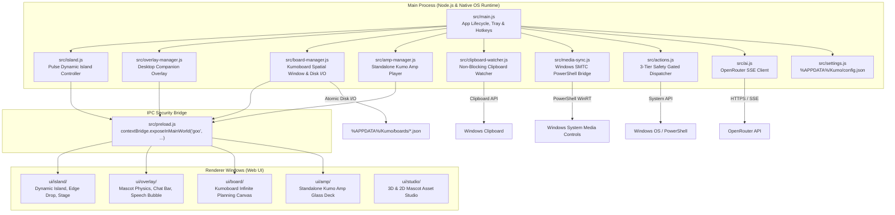

<div align="center">

# Kumo (雲)
### Animated AI Desktop Companion, Pulse Dynamic Island & Infinite Spatial Planning Canvas for Windows

<!-- Project & Repository Health Badges -->
[](LICENSE)
[](https://microsoft.com/windows)
[](https://github.com/Ashborn-047/kumo/pulls)
[](https://github.com/Ashborn-047/kumo)
[](https://github.com/Ashborn-047/kumo/stargazers)
[](https://github.com/Ashborn-047/kumo/network/members)
[](https://github.com/Ashborn-047/kumo/issues)

<br/>

<!-- Core Runtime & Technologies Badges -->
[](https://www.electronjs.org/)
[](https://nodejs.org/)
[](https://developer.mozilla.org/en-US/docs/Web/JavaScript)
[](https://developer.mozilla.org/en-US/docs/Web/API/Canvas_API)
[](https://developer.mozilla.org/en-US/docs/Web/CSS)
[](https://learn.microsoft.com/en-us/powershell/)
[](https://nsis.sourceforge.io/)
[](LATEST_RELEASE.md)

<br/>

<!-- AI & Storage Badges -->
[](https://openrouter.ai/)
[](https://ai.meta.com/)
[](https://deepmind.google/technologies/gemini/)
[](https://www.deepseek.com/)
[](https://localfirstweb.dev/)
[](https://github.com/Ashborn-047/kumo#3-tier-safety-system)

<p align="center">
  <b>Kumo</b> is a privacy-first, high-performance desktop productivity suite for Windows.<br/>
  Featuring an organic physics companion, the kinetic Pulse Dynamic Island bezel overlay, the Edge Drop desktop staging shelf, live Windows SMTC media control (Kumo Amp), real-time OpenRouter token streaming, a 3-tier desktop action safety gate, and an infinite spatial planning canvas ported from Mochiboard.
</p>

<!-- Latest Release Callout -->
<p align="center">
  <a href="https://github.com/Ashborn-047/kumo/releases/tag/v0.1.1">
    
  </a>
  <br/>
  <a href="https://github.com/Ashborn-047/kumo/releases/download/v0.1.1/Kumo-Setup-0.1.1.exe"><b>Download Setup Installer (.exe)</b></a> • 
  <a href="https://github.com/Ashborn-047/kumo/releases/download/v0.1.1/Kumo-0.1.1-portable.exe"><b>Download Portable (.exe)</b></a> • 
  <a href="LATEST_RELEASE.md"><b>Release Notes (v0.1.1)</b></a>
</p>

[Quick Start](#quick-start) • [Pulse Dynamic Island](#pulse-dynamic-island) • [Edge Drop Shelf](#edge-drop-desktop-shelf) • [Architecture](#system-architecture) • [Contributing](CONTRIBUTING.md) • [Code of Conduct](CODE_OF_CONDUCT.md) • [Security](SECURITY.md) • [License](LICENSE)

</div>

---

## Table of Contents
- [Why Kumo?](#why-kumo)
- [Key Features](#key-features)
  - [Pulse Dynamic Island](#pulse-dynamic-island)
  - [Edge Drop Desktop Shelf](#edge-drop-desktop-shelf)
  - [Kumo Amp & Windows SMTC](#kumo-amp--live-windows-smtc)
  - [Kumoboard Infinite Canvas](#kumoboard-infinite-spatial-canvas)
  - [Organic Mascot & Asset Studio](#organic-physics-mascot--asset-studio)
  - [Real-Time Streaming AI](#real-time-streaming-ai)
  - [3-Tier Safety Gate](#3-tier-safety-system)
  - [Live In-App Auto-Updates](#live-in-app-auto-updates)
- [System Architecture](#system-architecture)
  - [Architectural Overview](#architectural-overview)
  - [Component Deep Dive](#component-deep-dive)
  - [Data Flow & IPC Channel Specification](#data-flow--ipc-channel-specification)
- [Performance & Security Model](#performance--security-model)
- [Quick Start](#quick-start)
  - [Prerequisites](#prerequisites)
  - [One-Click Setup](#one-click-setup-powershell)
  - [Manual Setup](#manual-setup)
- [Hotkeys & Shortcuts](#hotkeys--shortcuts)
- [Extending Kumo (Developer Guide)](#extending-kumo)
- [Contributing](#contributing)
- [Packaging & Distribution](#packaging--distribution)
- [Roadmap](#roadmap)
- [License & Acknowledgments](#license--acknowledgments)

---

## Why Kumo?

Most desktop AI assistants are heavy application windows that clutter your taskbar, block desktop space, and require constant window switching.

**Kumo takes a unified, multi-tier spatial approach:**
1. **Zero-Gap Bezel Docking**: The **Pulse Dynamic Island** rests flush against your screen bezel (top, left, or right). It tucks into a passive 12px peek indicator, expands to a resting pill, and unrolls into a warm porcelain tool stage.
2. **Instant Desktop Staging**: The **Edge Drop Shelf** lets you drag, drop, and stage files, URLs, text snippets, and screenshots without switching apps. Group items into multi-item stacks and view them in full-screen lightboxes.
3. **Background Media Sync**: **Kumo Amp** interfaces directly with Windows System Media Transport Controls (SMTC) to display track titles, artists, album artwork, and interactive play/pause controls with live audio rhythm visualizers.
4. **Spatial Thinking**: **Kumoboard** provides an infinite canvas for cards, notes, tasks, images, connections, and AI brainstorming. Dual-mode card pinning routes drops between the island and the main board.
5. **Local-First & Privacy-Centric**: All boards, shelf items, and settings are stored locally on your machine in `%APPDATA%\Kumo`. System actions execute through strict, transparent safety gates.

---

## Key Features

### Pulse Dynamic Island
- **3-State Kinetic Morphing Chassis (`ui/island/`)**:
  - `Peek State` (120 x 12 px): A sleek, passive obsidian indicator sitting flush against the bezel.
  - `Resting State` (360 x 40 px): Displays companion orb, SMTC media track marquee, timecode, and quick play/pause.
  - `Unrolled State` (540 x 330 px+): Unrolls into a full porcelain deck featuring 4 dedicated modular widgets.
- **Dynamic Window Sizing & Non-Intrusive Passthrough**:
  - Automatically bounds the transparent Electron window (160x26 in peek, 400x56 in resting, 720x600 in unrolled).
  - Eliminates screen-blocking transparent hits and removes OS mouse hook contention with Windows Snipping Tool.
- **Drag-to-Resize Handle**: Tactile bottom drag bar to expand the deck from 330px up to 520px with local storage height memory.
- **Compact Icon Dock Navigation**: Replaces bulky text tabs with compact Jelly-Pop spring buttons, live status dots, and active card badges.
- **Multi-Edge Docking**: Dock seamlessly to Top Bezel, Left Edge, or Right Edge.

### Edge Drop Desktop Shelf
- **Desktop Staging Area (`ui/island/edge-drop/`)**:
  - Drop files, images, code snippets, and web links directly onto the shelf or ambient drop targets.
  - Native drag-out: drag items back into any desktop app (Photoshop, VS Code, Discord, Slack, Explorer).
- **Copy as Usual Daemon (`src/clipboard-watcher.js`)**:
  - Non-blocking background watcher captures copied text, URLs, and screenshots into the shelf.
  - Efficient 48-byte bitmap memory sampling avoids heavy PNG encoding on idle intervals and prevents Windows clipboard locks.
- **Stacks (Multi-Item Bundles)**: Drag and drop cards on top of each other to bundle them into layered stacks with count badges.
- **Full-Size Lightbox Preview**: Inspect full screenshots, long code blocks, and stack contents in an expanded modal.
- **Clickable Links**: Direct one-click URL opening in your default system browser.
- **Kumoboard Stash Deck Integration**: Send items from the shelf directly to Kumoboard via the dedicated Edge Drop stash deck.

### Kumo Amp & Live Windows SMTC
- **Live System Media Transport Controls (`src/media-sync.js`, `ui/amp/`)**:
  - Intercepts active playback from Spotify, Chrome, Edge, iTunes, and Windows Media Player.
  - Live metadata: song title, artist, album art, position, duration, and play/pause/prev/next controls.
- **Audio Rhythm Visualizer**: Real-time frequency waveform animation reactive to system sound playback.
- **Standalone Amp Mini-Player**: Pop out a compact glassmorphic desktop music deck with volume control and track queue.

### Kumoboard Infinite Spatial Canvas
- **Spatial Planning Canvas (`ui/board/`)**:
  - Infinite pan/zoom canvas for notes, checklists, code blocks, cards, and arrows.
  - 9 Synchronized default cards (`#TELEMETRY`, `#NETWORK`, `#MEDIA`, `#WORKSPACE`, `#LAUNCHER`, `#AI-STUDIO`, `#TERMINAL`, `#TODO`, `#THEME-LAB`).
  - Dual-mode card pinning: pin cards from the mascot popout or Edge Drop directly into your workspace.
  - Atomic JSON persistence in `%APPDATA%\Kumo\boards\`.

### Organic Physics Mascot & Asset Studio
- **Procedural Bézier Mascot (`ui/overlay/goo.js`)**:
  - Rendered on HTML5 Canvas with breathing, eye-gaze tracking, blinking, hopping, and sleep mode with floating particles.
  - Companion Spatial Migration ("Dive-In / Leap-Out"): Mascot leaps between the desktop overlay, the island pill, and the board.
- **3D & 2D Asset Studio (`ui/studio/`, `assets/Lab/`)**: Personalization suite to customize mascot palettes, lighting, and expressions.

### Real-Time Streaming AI
- **OpenRouter Streaming Integration (`src/ai.js`)**:
  - Access to top open models (`Llama 3.3 70B`, `Gemini Flash 1.5`, `DeepSeek R1`, `Qwen 2.5 72B`).
  - Server-sent events (SSE) token streaming directly into dynamic speech bubbles.

### 3-Tier Safety System
- **Action Security Gate (`src/actions.js`)**:
  - `GREEN`: Silent execution for safe, read-only operations (clipboard read/write, scoped file search, browser URL opening).
  - `YELLOW`: Explicit user confirmation for system modifications (app launch, folder open, PowerShell inspection).
  - `RED`: Automatic refusal for destructive actions (file deletion, formatting, registry edits).

### Live In-App Auto-Updates
- **Zero-Downtime Patch Delivery (`src/updater.js`, `ui/board/js/updater-ui.js`)**:
  - Powered by `electron-updater` with differential binary blockmap deltas.
  - Discreet, glassmorphic floating notification pill in the Kumoboard canvas displaying real-time download progress.
  - One-click restart hot-swap to apply updates immediately with zero user canvas data loss.
  - See full release highlights in [LATEST_RELEASE.md](LATEST_RELEASE.md).

---

## System Architecture

### Architectural Overview

Kumo is built on **Electron 31**, strictly enforcing `contextIsolation: true` and `nodeIntegration: false`. The renderer communicates with the Node.js main process exclusively via typed IPC channels defined in [`src/preload.js`](src/preload.js).



### Component Deep Dive

| Component | Path | Responsibility |
|---|---|---|
| **Main Process Entry** | [`src/main.js`](src/main.js) | Application lifecycle, global hotkeys, background service bootstrap, and tray setup. |
| **Pulse Dynamic Island** | [`src/island.js`](src/island.js) | Multi-edge docking controller, dynamic state-based window bounds, and hit-testing. |
| **Clipboard Watcher** | [`src/clipboard-watcher.js`](src/clipboard-watcher.js) | Non-blocking background clipboard daemon with memory sampling and zero Snipping Tool locks. |
| **Media Sync Engine** | [`src/media-sync.js`](src/media-sync.js) | Windows SMTC background integration running [`src/media-helper.ps1`](src/media-helper.ps1). |
| **Overlay Window** | [`src/overlay-manager.js`](src/overlay-manager.js) | Frameless transparent desktop companion window with click passthrough. |
| **Canvas Manager** | [`src/board-manager.js`](src/board-manager.js) | Spawns Kumoboard window with atomic file swap persistence in `%APPDATA%\Kumo\boards\`. |
| **Security Bridge** | [`src/preload.js`](src/preload.js) | Sandboxed API context bridge (`window.goo.*`). |
| **Safety Actions Dispatcher** | [`src/actions.js`](src/actions.js) | 3-tier action validation for safe computer interaction. |
| **AI Streaming Client** | [`src/ai.js`](src/ai.js) | OpenRouter SSE client with tool-calling and structured canvas actions. |
| **Island Stage & Edge Drop** | [`ui/island/`](ui/island/) | Unrolled chassis, icon-only dock, Edge Drop shelf, Stacks, and Lightbox preview. |
| **Kumoboard Engine** | [`ui/board/`](ui/board/) | Spatial planning canvas engine, card connectors, and Edge Drop stash deck. |

### Data Flow & IPC Channel Specification

```
Renderer (Island / Board / Overlay)             Main Process (Node.js)
         │                                              │
         │─── ipcRenderer.send('chat:message') ────────>│ (src/main.js)
         │                                              ├── ai.chatStream()
         │<── ipcRenderer.sendToFrame('chat:stream') ───┤ (Streams tokens to UI)
         │                                              │
         │─── ipcRenderer.send('island:set-state') ────>│ (src/island.js)
         │                                              ├── Resize window bounds (160x26 -> 720x600)
         │                                              │
         │<── ipcRenderer.on('island:clipboard-change')─┤ (src/clipboard-watcher.js)
         │                                              ├── Push auto-copied text, links & snips
         │                                              │
         │─── ipcRenderer.invoke('media:get-status') ──>│ (src/media-sync.js)
         │<── returns { title, artist, isPlaying } ─────┤
```

---

## Performance & Security Model

- **Zero Screen Blockage**: In passive peek state, the island window bounds shrink to `160 x 26 px`, leaving the rest of your screen completely clear and free of transparent hitboxes.
- **Snipping Tool Friendly**: Standard `alwaysOnTop: true` priority and non-blocking clipboard sampling ensure Windows Snipping Tool (`Win+Shift+S`) never freezes or deadlocks.
- **Memory Footprint**: Typical idle usage is ~50MB RAM for the island and ~60MB for the desktop companion overlay.
- **CPU Throttling**: The companion render loop automatically throttles frame rates during inactivity and sleep states.
- **Zero Telemetry**: Kumo never sends analytics or telemetry. Outbound traffic is restricted to OpenRouter for AI inference.
- **Atomic Disk Writes**: Canvas boards use atomic `.tmp` file swapping to prevent corruption during unexpected shutdowns.

---

## Quick Start

### Prerequisites
- **OS**: Windows 10 or 11 (64-bit)
- **Node.js**: v20.0.0 or higher ([Download Node.js](https://nodejs.org/))
- **OpenRouter Key**: Free API key from [OpenRouter](https://openrouter.ai/keys) (optional, for AI features)

### One-Click Setup (PowerShell)

```powershell
git clone https://github.com/Ashborn-047/kumo.git
cd kumo
./install.ps1
```

### Manual Setup

```powershell
# 1. Install dependencies
npm install

# 2. Start the native desktop application
npm start
```

---

## Hotkeys & Shortcuts

| Action | Shortcut | Target |
|---|---|---|
| **Summon / Focus Chat** | <kbd>Alt</kbd> + <kbd>Space</kbd> | Global (works from any application) |
| **Dock / Collapse Island** | <kbd>Esc</kbd> | Pulse Dynamic Island |
| **Hover to Reveal Island** | Mouse hover on top bezel | Pulse Dynamic Island Peek Tab |
| **Toggle Mascot Companion** | Click Mascot Orb in Island Header | Dynamic Island / Overlay |
| **Toggle Chat Input** | Left Click on Mascot | Desktop Companion Overlay |
| **Reposition Companion** | Click & Drag Mascot | Desktop Companion Overlay |
| **Open Planning Canvas** | Click Board Icon in Island Dock | Spawns Kumoboard Window |
| **Open Kumo Amp Player** | Click SMTC Badge / Amp Tab | Spawns Standalone Amp Deck |
| **Open Settings & Studio** | Click Settings Icon | Overlay / Studio Window |

---

## Extending Kumo

### 1. Adding a New Desktop Action

All system interactions are handled in [`src/actions.js`](src/actions.js):

1. **Define the action handler:**
   ```javascript
   async function getBatteryStatus() {
     return { percent: 85, charging: true };
   }
   ```
2. **Assign a safety tier & register it:**
   ```javascript
   const TIERS = {
     'system.battery': 'GREEN', // Safe read-only
   };

   // Inside dispatch():
   case 'system.battery':
     return { success: true, result: await getBatteryStatus() };
   ```
3. **Register in `SYSTEM_PROMPT` inside [`src/ai.js`](src/ai.js)** so Kumo can trigger it via tool calls.

### 2. Adding Modular Widgets to Pulse Island

The modular stage in [`ui/island/`](ui/island/) supports extensible widgets:
- Add a new tab button to `<nav class="modular-nav">` in [`ui/island/index.html`](ui/island/index.html).
- Add a corresponding panel container `<div class="widget-panel" id="panel-yourwidget">`.
- Register the tab switch target in [`ui/island/island.js`](ui/island/island.js).

---

## Packaging & Distribution

### Local Builds
To compile assets and build standalone Windows binaries locally:

```powershell
# Compiles assets and builds Windows NSIS installer + portable exe in dist/
npm run dist
```

Generated binaries:
- `dist/Kumo-Setup-0.1.1.exe` (NSIS Installer)
- `dist/Kumo-0.1.1-portable.exe` (Standalone Portable)

### Automated Releases & Publishing
To publish a new verified release to GitHub:

```powershell
# Runs local test gates, updates version, tags with notes, and triggers CI release
npm run release
```

---

## Roadmap

- [x] Organic canvas companion with Bézier physics & gaze tracking
- [x] OpenRouter SSE streaming chat integration
- [x] Port of Mochiboard infinite canvas with native Electron IPC bridge
- [x] Pulse Dynamic Island with 3-state morphing chassis (peek, resting, unrolled)
- [x] Multi-edge bezel docking (Top, Left, Right)
- [x] Edge Drop desktop shelf for drag, drop, and staging
- [x] Non-blocking clipboard daemon with fast memory sampling
- [x] Stacks (multi-item drag-to-group bundles) and lightbox preview modal
- [x] Live Windows SMTC media integration (Kumo Amp) & audio rhythm visualizer
- [x] Compact icon-only navigation dock to maximize stage space
- [x] 3D & 2D Mascot Asset Studio & Theme Lab
- [x] 3-Tier safety gate for system actions
- [x] Live in-app background auto-updates & differential patch delivery (electron-updater)
- [ ] Multi-monitor display selection
- [ ] Voice input / TTS audio feedback
- [ ] System tray notification badges for reminders

---

## Contributing

We welcome contributions to Kumo. Whether fixing a bug, adding a new action, or polishing UI components, here is how you can help:

1. **Review our Guidelines**: Please read our [Contributing Guide](CONTRIBUTING.md) and [Code of Conduct](CODE_OF_CONDUCT.md).
2. **Zero-Emoji Policy**: Kumo enforces a strict zero-emoji standard across all source code, comments, UI strings, and commit messages. Use Lucide SVG icons instead.
3. **Verify Tests**: Ensure syntax checks and test suites pass locally before submitting:
   ```powershell
   npm run test:unit
   npm run test:e2e
   ```
4. **Submit a Pull Request**: Create a feature branch, commit with Conventional Commits, and submit a PR for review.

For security concerns, please refer to our [Security Policy](SECURITY.md).

---

## License & Acknowledgments

- **License**: Released under the [MIT License](LICENSE).
- **Mochiboard Engine**: Spatial canvas ported from the work in [Mochiboard](https://github.com/jessawolfe-ux/mochiboard) (MIT).
- **Icons**: Lucide SVG Icons & Material Icons (MIT / Apache 2.0).

---

<div align="center">
  <sub>Built with care by <a href="https://github.com/Ashborn-047">Ashborn-047</a></sub>
</div>
