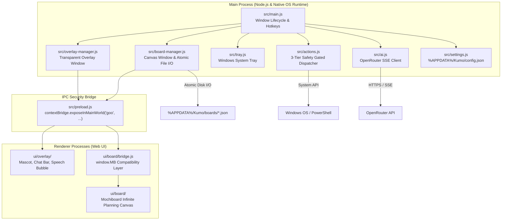

<div align="center">

# ☁️ Kumo (雲)
### Animated AI Desktop Companion & Infinite Spatial Planning Canvas for Windows

<!-- Project & Repository Health Badges -->
[](LICENSE)
[](https://microsoft.com/windows)
[](https://github.com/Ashborn-047/kumo/pulls)
[](https://github.com/Ashborn-047/kumo)
[](https://github.com/Ashborn-047/kumo/stargazers)
[](https://github.com/Ashborn-047/kumo/network/members)
[](https://github.com/Ashborn-047/kumo/issues)

<br/>

<!-- Core Runtime & Technologies Badges -->
[](https://www.electronjs.org/)
[](https://nodejs.org/)
[](https://developer.mozilla.org/en-US/docs/Web/JavaScript)
[](https://developer.mozilla.org/en-US/docs/Web/API/Canvas_API)
[](https://developer.mozilla.org/en-US/docs/Web/CSS)
[](https://learn.microsoft.com/en-us/powershell/)
[](https://nsis.sourceforge.io/)

<br/>

<!-- AI & Storage Badges -->
[](https://openrouter.ai/)
[](https://ai.meta.com/)
[](https://deepmind.google/technologies/gemini/)
[](https://www.deepseek.com/)
[](https://github.com/QwenLM)
[](https://localfirstweb.dev/)
[](https://github.com/Ashborn-047/kumo#-3-tier-safety-system)

<p align="center">
  <b>Kumo</b> is a high-performance, privacy-first desktop companion for Windows.<br/>
  Featuring an organic physics-animated canvas mascot, real-time token streaming via OpenRouter, a 3-tier desktop automation safety gate, and an infinite spatial planning canvas ported from Mochiboard.
</p>

[Quick Start](#-quick-start) • [Architecture](#-system-architecture) • [Security & Safety](#-3-tier-safety-system) • [Developer Guide](#-extending-kumo) • [Hotkeys](#-hotkeys--shortcuts)

</div>

---

## 📖 Table of Contents
- [Why Kumo?](#-why-kumo)
- [Key Features](#-key-features)
- [System Architecture](#-system-architecture)
  - [Architectural Overview](#architectural-overview)
  - [Component Deep Dive](#component-deep-dive)
  - [Data Flow & IPC Channel Specification](#data-flow--ipc-channel-specification)
- [3-Tier Safety System](#-3-tier-safety-system)
- [Performance & Security Model](#-performance--security-model)
- [Quick Start](#-quick-start)
  - [Prerequisites](#prerequisites)
  - [One-Click Setup](#one-click-setup-powershell)
  - [Manual Setup](#manual-setup)
- [Hotkeys & Shortcuts](#-hotkeys--shortcuts)
- [Extending Kumo (Developer Guide)](#-extending-kumo)
  - [1. Adding New Desktop Actions](#1-adding-a-new-desktop-action)
  - [2. Adding Mascot States & Animations](#2-adding-a-mascot-animation-or-emotion)
  - [3. Configuring AI Models](#3-configuring-ai-models)
- [Packaging & Distribution](#-packaging--distribution)
- [Roadmap](#-roadmap)
- [License & Acknowledgments](#-license--acknowledgments)

---

## 💡 Why Kumo?

Most desktop AI assistants are clunky Electron windows or browser tabs that consume screen real estate and demand constant alt-tabbing. 

**Kumo takes a fundamentally different design approach:**
1. **Unobtrusive & Organic**: Lives as a frameless, transparent canvas blob directly on your wallpaper. Transparent regions let normal mouse clicks pass straight through to whatever application is behind it (`setIgnoreMouseEvents(true, { forward: true })`).
2. **Instant Accessibility**: Press <kbd>Alt</kbd> + <kbd>Space</kbd> anywhere in Windows to summon Kumo's glassmorphic chat bar.
3. **Spatial Thinking**: Instead of losing notes in endless chat transcripts, Kumo includes an integrated, local-first infinite planning canvas (notes, to-dos, cards, connections, typography).
4. **Local-First & Safe**: All boards and settings are stored locally on your machine in `%APPDATA%\Kumo`. No remote tracking, no telemetry, and all system actions pass through strict execution safety gates.

---

## ✨ Key Features

- **🐾 Organic Physics Mascot (`ui/overlay/goo.js`)**:
  - Rendered entirely on HTML5 Canvas using cubic Bézier curves.
  - Procedural breathing, blinking, squash-and-stretch hopping, and real-time cursor gaze tracking.
  - Sleep mode: Enters slumber with floating `Zzz` particles after 60 seconds of inactivity; wakes up on mouse movement.
  - Five expressive emotional states: `idle`, `thinking`, `talking`, `happy`, and `sleeping`.

- **💬 Real-Time Streaming AI (`src/ai.js`)**:
  - Powered by [OpenRouter](https://openrouter.ai/) for access to free, state-of-the-art open models (`Llama 3.3 70B`, `Gemini Flash 1.5`, `DeepSeek R1`, `Qwen 2.5 72B`).
  - True token-by-token server-sent event (SSE) streaming directly into an animated speech bubble.
  - Conversation history with persistent in-memory caching and exportable logs.

- **📋 Infinite Spatial Planning Canvas (`ui/board/`)**:
  - Full infinite canvas ported from Mochiboard.
  - Add text notes, task lists, inspirational images, and connectors.
  - Atomic JSON disk persistence in `%APPDATA%\Kumo\boards\`.
  - Built-in AI Canvas Assistant: Ask Kumo to brainstorm ideas, structure research, or populate cards directly on your board.

- **🛡️ 3-Tier Security Gate (`src/actions.js`)**:
  - Protects your workstation with transparent execution policies (`GREEN` silent, `YELLOW` confirmation prompt, `RED` hard refusal).

---

## 🏗️ System Architecture

### Architectural Overview

Kumo is built on **Electron 31**, strictly enforcing `contextIsolation: true` and `nodeIntegration: false`. The renderer communicates with the Node.js main process exclusively via typed IPC channels defined in [`src/preload.js`](src/preload.js).



### Component Deep Dive

| Component | Path | Responsibility |
|---|---|---|
| **Main Process Entry** | [`src/main.js`](src/main.js) | App lifecycle, global hotkey registration (<kbd>Alt</kbd>+<kbd>Space</kbd>), IPC endpoint routing, tray setup. |
| **Overlay Window Controller** | [`src/overlay-manager.js`](src/overlay-manager.js) | Coordinates the transparent, frameless, always-on-top companion window. Manages dynamic click pass-through via `setIgnoreMouseEvents`. |
| **Canvas Manager & I/O** | [`src/board-manager.js`](src/board-manager.js) | Spawns the 1280x800 Mochiboard window. Manages atomic writes (`.tmp` → swap) in `%APPDATA%\Kumo\boards\`. |
| **Security Preload Bridge** | [`src/preload.js`](src/preload.js) | Context bridge exposing sandboxed APIs (`window.goo.sendMessage`, `window.goo.action`, `window.goo.board.*`). |
| **Safety Actions Dispatcher** | [`src/actions.js`](src/actions.js) | Validates and dispatches desktop actions (clipboard, fast file search, app launching) according to security tiers. |
| **AI Streaming Client** | [`src/ai.js`](src/ai.js) | Connects to OpenRouter OpenAI-compatible streaming endpoints. Handles prompt injection, structured action parsing (`[ACTION:{...}]`), and canvas helpers. |
| **Mascot Physics & Canvas** | [`ui/overlay/goo.js`](ui/overlay/goo.js) | Canvas 2D render loop. Handles Bézier deformation, procedural eye-gaze tracking, blinking, hop physics, and sleep particles. |
| **Mochiboard Bridge** | [`ui/board/bridge.js`](ui/board/bridge.js) | Polyfills 29 native methods (`window.MB`) required by the Mochiboard canvas engine, routing file operations through Electron IPC. |

### Data Flow & IPC Channel Specification

```
Renderer (Overlay / Board)                    Main Process (Node.js)
         │                                              │
         │─── ipcRenderer.send('chat:message') ────────>│ (src/main.js)
         │                                              ├── ai.chatStream()
         │<── ipcRenderer.sendToFrame('chat:stream') ───┤ (Streams tokens to UI)
         │                                              │
         │─── ipcRenderer.invoke('board:save') ────────>│ (src/board-manager.js)
         │                                              ├── Atomic write (.tmp -> .json)
         │<── returns { success: true } ────────────────┤
         │                                              │
         │─── ipcRenderer.invoke('system:action') ─────>│ (src/actions.js)
         │                                              ├── 3-Tier Security Inspection
         │<── returns { success, result } ──────────────┤
```

---

## 🛡️ 3-Tier Safety System

To ensure that autonomous AI agents cannot harm user workstations, Kumo enforces a strict 3-tier safety gate inside [`src/actions.js`](src/actions.js):

```
                        ┌─────────────────────────────────┐
                        │   AI Proposes Desktop Action    │
                        └────────────────┬────────────────┘
                                         │
                 ┌───────────────────────┼───────────────────────┐
                 ▼                       ▼                       ▼
         ┌───────────────┐       ┌───────────────┐       ┌───────────────┐
         │     GREEN     │       │    YELLOW     │       │      RED      │
         │  Safe / Read  │       │ System Mod /  │       │ Destructive / │
         │   Automated   │       │ User Preview  │       │  Dangerous    │
         └───────┬───────┘       └───────┬───────┘       └───────┬───────┘
                 │                       │                       │
                 ▼                       ▼                       ▼
           Execute Now           Require User Consent      Permanently Block
        (Clipboard, Read,      (App Launch, PowerShell,   (Delete, Format,
          File Search)              Open Explorer)          Registry Mod)
```

1. **🟢 GREEN (Silent Execution)**:
   - Read / Write Clipboard (`clipboard.read`, `clipboard.write`)
   - Fast file search scoped to user directories (`file.search`)
   - Open safe web URLs in default browser (`url.open`)
   - Query system date, time, and hardware specs (`system.time`, `system.info`)

2. **🟡 YELLOW (Confirmation Preview)**:
   - Launch local applications (`app.open`: Notepad, Calculator, VS Code, Chrome, etc.)
   - Open folder paths in Windows Explorer (`folder.open`)
   - Read-only PowerShell queries (`powershell.read`)

3. **🔴 RED (Hard Blocked)**:
   - Arbitrary script execution, file deletion, disk formatting, registry edits.
   - Refused automatically with a security alert.

---

## ⚡ Performance & Security Model

- **Memory Footprint**: Average idle memory consumption is ~60MB RAM for the overlay window and ~120MB when the infinite canvas is actively running.
- **CPU Overhead**: Mascot rendering uses `requestAnimationFrame` with dirty-checking; when Kumo goes into sleep mode after 60s of inactivity, frame rates throttle down automatically to save CPU/GPU cycles.
- **Zero Telemetry**: Kumo never dials home. Only outbound calls are direct HTTPS connections to OpenRouter for AI inference.
- **Atomic File Saving**: Boards are written to a `.tmp` file first and swapped atomically via `fs.renameSync`, preventing file corruption during sudden system shutdowns.
- **Electron Hardening**:
  - `contextIsolation: true`
  - `nodeIntegration: false`
  - `sandbox: false` (only for preload bridge)
  - `enableRemoteModule: false`

---

## 🚀 Quick Start

### Prerequisites
- **OS**: Windows 10 or 11 (64-bit)
- **Node.js**: v20.0.0 or higher ([Download Node.js](https://nodejs.org/))
- **OpenRouter Key**: Free API key from [OpenRouter](https://openrouter.ai/keys)

### One-Click Setup (PowerShell)

Clone the repository and run the included installer:

```powershell
git clone https://github.com/Ashborn-047/kumo.git
cd kumo
./install.ps1
```

### Manual Setup

```powershell
# 1. Install dependencies
npm install

# 2. Start the native desktop application
npm start
```

On first launch:
1. Click the ⚙️ gear icon above Kumo to open **Settings**.
2. Paste your **OpenRouter API Key** (`sk-or-v1-...`).
3. Pick your preferred mascot pastel color theme and start chatting!

---

## ⌨️ Hotkeys & Shortcuts

| Action | Shortcut | Target |
|---|---|---|
| **Summon / Focus Chat** | <kbd>Alt</kbd> + <kbd>Space</kbd> | Global (works from any app) |
| **Toggle Chat Input** | Left Click on Mascot | Overlay Window |
| **Reposition Companion** | Click & Drag Mascot | Overlay Window |
| **Open Planning Canvas** | Click 📋 icon on hover | Spawns Mochiboard Window |
| **Open Chat History** | Click 💬 icon on hover | Overlay Window |
| **Open Settings** | Click ⚙️ icon on hover | Overlay Window |
| **Dismiss Chat / Bubble** | <kbd>Esc</kbd> or click wallpaper | Active Window |

---

## 🛠️ Extending Kumo

### 1. Adding a New Desktop Action

All computer interactions are handled in [`src/actions.js`](src/actions.js). To add a new action (e.g., getting battery percentage or volume control):

1. **Define the handler function:**
   ```javascript
   async function getBatteryStatus() {
     // Run native command or query
     return { percent: 85, charging: true };
   }
   ```
2. **Assign a safety tier & register it in `dispatch`:**
   ```javascript
   const TIERS = {
     'system.battery': 'GREEN', // Safe read-only
   };

   // Inside dispatch():
   case 'system.battery':
     return { success: true, result: await getBatteryStatus() };
   ```
3. **Expose the action in `SYSTEM_PROMPT` in [`src/ai.js`](src/ai.js)** so Kumo knows how to invoke it.

### 2. Adding a Mascot Animation or Emotion

Mascot rendering is managed by the 2D loop in [`ui/overlay/goo.js`](ui/overlay/goo.js):

- **Add an emotional state:** Add your state to the state machine in `goo.js`:
  ```javascript
  // Example: Surprised state with wide eyes
  if (state === 'surprised') {
    eyeScaleY = 1.4;
    pupilScale = 0.7;
  }
  ```
- **Trigger from chat controller:** Call `window.gooState.setStateTemp('surprised', 2000)` inside [`ui/overlay/chat.js`](ui/overlay/chat.js).

### 3. Configuring AI Models

OpenRouter supports hundreds of models. You can add or change default models in [`src/ai.js`](src/ai.js) and [`ui/overlay/index.html`](ui/overlay/index.html):

```javascript
const FREE_MODELS = [
  'meta-llama/llama-3.3-70b-instruct:free',
  'google/gemini-flash-1.5:free',
  'deepseek/deepseek-r1:free',
  'qwen/qwen-2.5-72b-instruct:free'
];
```

---

## 📦 Packaging & Distribution

To build a standalone Windows `.exe` installer (NSIS):

```powershell
# Compiles assets and builds Windows installer in dist/
npm run dist
```

The resulting package will be generated under:
```
dist/Kumo Setup 0.1.0.exe
```

---

## 🗺️ Roadmap

- [x] Organic canvas companion with Bézier physics & gaze tracking
- [x] OpenRouter SSE streaming chat integration
- [x] Port of Mochiboard infinite canvas with native Electron IPC bridge
- [x] 3-Tier safety gate for system actions
- [x] Inactivity sleep mode with floating particles
- [x] Color swatch personalizer & glassmorphism settings
- [ ] Multi-monitor support (snap to different screens)
- [ ] Voice input / TTS voice feedback
- [ ] Notification badges on Windows System Tray for calendar / reminders
- [ ] Canvas snapshot thumbnail previews in chat bubble

---

## 📄 License & Acknowledgments

- **License**: Released under the [MIT License](LICENSE).
- **Mochiboard Engine**: Spatial canvas ported from the brilliant work in [Mochiboard](https://github.com/jessawolfe-ux/mochiboard) (MIT).
- **Icons**: [Material Icons](https://fonts.google.com/icons) (Apache 2.0).

---

<div align="center">
  <sub>Built with ☁️ by <a href="https://github.com/Ashborn-047">Ashborn-047</a></sub>
</div>
