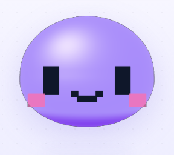
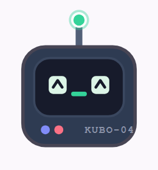
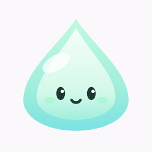

# Kumo Mascot Assets & Companion Gallery (Single Source of Truth)

This directory is the **canonical source of truth** for all mascot assets in Kumo Companion. Every mascot includes vector SVGs, high-resolution PNG renders, WebGL/Canvas source references, and **all 5 animation states**: `idle`, `speaking`, `listening`, `happy`, and `thinking`.

---

## Canonical Companion Gallery

| Companion | Preview Image | Type / Engine | Animation States |
| :--- | :---: | :--- | :--- |
| **2D Pixel Cloud (Puff)** |  | **Canvas 2D SDF / Bayer Dither** `assets/mascot/2d/` | `idle.png`, `speaking.png`, `listening.png`, `happy.png`, `thinking.png`, `spritesheet.png` |
| **3D Voxel Bot (Cube)** |  | **Three.js Isometric Voxel Mesh** `assets/mascot/3d/` | `idle.png`, `speaking.png`, `listening.png`, `happy.png`, `thinking.png`, `spritesheet.png` |
| **3D Mochi Gel Bot** |  | **Three.js Smooth Gel Dome** `assets/mascot/3d-mochi-gel/` | Live WebGL shader with Blinn-Phong specular, Fresnel rim, spring jiggle |
| **Cotton Cloud (Puff)** |  | **Vector SVG Bezier** `assets/mascot/cotton-cloud/` | `idle.png/svg`, `speaking.png/svg`, `listening.png/svg`, `happy.png/svg`, `thinking.png/svg` |
| **Kubo Bot (CRT)** |  | **CRT Screen & Reactive VU** `assets/mascot/kubo-bot/` | `idle.png/svg`, `speaking.png/svg`, `listening.png/svg`, `happy.png/svg`, `thinking.png/svg` |
| **Mochi Droplet** |  | **Aquatic Jelly Teardrop** `assets/mascot/mochi-droplet/` | `idle.png/svg`, `speaking.png/svg`, `listening.png/svg`, `happy.png/svg`, `thinking.png/svg` |

---

## 5 Animated Mood States
All companions respond in real time to the 5 core assistant states:
1. **`idle`**: Resting calm smile, gentle floating breathing cycle.
2. **`speaking`**: Active vocal mouth articulation and soundwave equalizer pulses.
3. **`thinking`**: Upward gaze shift, blinking antenna/beacon, ideation sparkles.
4. **`happy`**: Joyful curved `^_^` eyes, blushing cheeks, double hop/bounce impulse.
5. **`listening`**: Attentive focused eyes with listening sound ring ripples.

---

## Desktop & System Icons
Found in [`assets/mascot/icons/`](./icons/):
- `icon.ico` — Windows application executable icon.
- `icon.png` — High-resolution 256x256 window & taskbar icon.
- `tray.png` / `tray@2x.png` — Windows system tray status icons.
